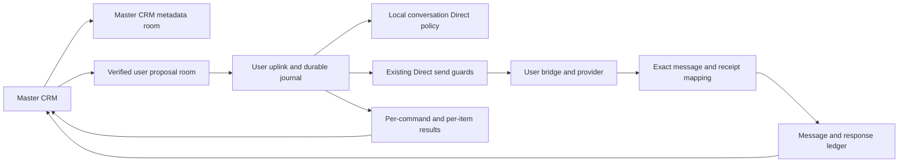

# Beepa master CRM design and implementation specification

Status: integrated and verified locally, October 12, 2026. After reviewing the integrated preview, the user authorized integration into the existing application, with independent testing and adversarial review throughout. See the [implementation verification record](2026-10-12-master-crm-verification.md) for requirement-level evidence and explicit capability boundaries. The preview remains fictional. No rollout or live outreach has occurred as part of this implementation.

Beepa’s master will manage central contact lists spanning connected users, prepare personalized messages, review and submit a batch, and track each outgoing message with its delivery evidence and linked response. Each membership pins a sending-account binding; adding it enables Direct on that selected user’s existing conversations. The master signs in once and orchestrates the whole list centrally; recipients see messages from the selected connected accounts. The user’s local agent remains the authority that changes permissions, checks whether sending is allowed, and dispatches messages through the connected account.

## Confirmed product decisions

| Decision | Required behavior |
| --- | --- |
| List ownership | Lists belong to the master workspace and can combine contacts from several managed users. The master reviews and submits one central batch, with an explicit sender for each recipient. |
| Shared people | One person can be shared by Elliot and David and appear in master lists, with explicit sender assignment and independent account histories. |
| Contact source | Version one uses only contacts already shared by that user. No master-created recipients, CSV import, or unshared address book browsing. |
| Send workflow | Select contacts, personalize individual messages, review the batch, then submit. |
| Automatic Direct | Adding a contact sets their existing conversations to Direct, including conversations explicitly marked Private. |
| Removal | Removing a contact from the last list leaves Direct enabled until someone changes it manually. |
| Starting conversations | Preserve user approval for starting a new conversation. A list does not grant permission to start one automatically. |
| Automatic response | The next incoming message is linked to the most recent unanswered outreach message in that same conversation. |
| Receipt appearance | One gray check for sending, two gray checks for delivered, two blue checks for read. Unsupported or absent receipt evidence never becomes a blue check. |
| Delivery scope now | Integrate the reviewed workflow into the existing application, reuse existing functionality, document it, and independently test and adversarially review it before release. |

These product decisions are confirmed by the user's answers and subsequent implementation instruction. Proposed engineering defaults below are explicitly marked and can be refined during implementation without altering these decisions.

## User experience

### Central lists across managed accounts

The master opens Contact lists in one central workspace. A list such as Founder introductions can contain Maya through Elliot and Noah through David. A sender filter narrows the visible rows without changing list ownership or clearing selections. The sending account remains explicit on every row, composed message, review group and history record. Display names are labels; verified Matrix identity and enrollment generation determine the sender.

Create, rename, archive, and restore master lists. Adding an already-present person is idempotent under the proposed one-message-per-person default. A person may appear in several master lists without duplicating their underlying account histories. Archive and removal change organization, not messaging permission. The UI states that Direct remains enabled.

The Add contacts picker combines contacts already shared by any connected user. For contacts shared by multiple users, show the eligible account bindings and require one selected sender; never infer a cross-account identity from a similar name. This version sends one message per canonical person in a batch, through the account the master chooses. Deliberate multi-account fan-out to one person is outside this version; duplicate sends never happen implicitly.

Adding a member requests Direct only for the selected sending-account binding, including its existing Private conversations. Other eligible users do not receive a grant just because they share that person. Changing the assigned sender is an explicit membership-binding change: review its effects, request Direct for the new binding, and wait for that agent’s acknowledgment. The previous binding remains Direct until changed manually, consistent with the confirmed removal rule. Pending grants and messages for the previous membership version become stale.

Once membership is accepted, the row appears with a pending permission status. The master cannot send on the strength of a membership row or account picker alone. No list operation copies contacts, credentials, or message histories between user accounts.

The user-side agent resolves the contact to its existing one-to-one conversations, applies Direct, and reports the per-conversation results. Changing Private to Direct also makes the conversation eligible for the existing sharing/mirroring pipeline; this may expose history according to Beepa’s normal mirror behavior. This effect must be stated in the add dialog. Do not promise that only future messages will become visible.

A contact with several channels can have several results. Show ready channels separately from disconnected, unavailable, or still syncing channels. Group conversations are excluded from automatic grants in the proposed first version: sharing one participant does not establish ownership of every participant’s conversation. Existing one-to-one conversations means those currently bound to that user’s verified contact profile; ambiguous handle matches need correction before a grant.

Adding the same account binding to an additional list triggers reconciliation of that binding’s existing conversations again. Ordinary background refresh does not repeatedly overwrite a manual permission change. A later explicit user change to Share or Private takes effect, is shown in CRM, and blocks automatic sending until an explicit new Direct operation is requested. Removal never performs an automatic downgrade.

### Compact rows and contact detail

Contact lists use compact rows, with approximately 60-pixel desktop row height rather than large contact cards. Clicking anywhere on the non-interactive part of a row opens contact detail; the name remains a native keyboard-accessible button. Checkboxes and sender selectors retain their own actions and must not accidentally navigate. On touch screens, controls retain usable touch targets even when this increases row height.

The detail view shows “Where we have them”: each shared user-account/channel binding, the shared contact handle, conversation availability and current access state. Choosing a conversation opens that account’s messages without changing the list’s assigned sender. A separate list-membership section shows every master list containing the person and the sender assigned in each; those entries navigate to the corresponding list.

The first version only exposes identities and conversations already visible to the master through verified sharing. A shared address-book contact without a conversation shows an explicit empty state and the existing new-chat approval requirement. Actual production routing must enumerate distinct conversation IDs per account/channel, not collapse several rooms merely because they use the same provider. The preview illustrates Maya on Elliot’s iMessage and David’s WhatsApp, with independent history. Message receipts and response links remain conversation-specific.

### Compose and review

Selection spans the sending accounts represented in one master list. The proposed default deduplicates by canonical person across the parent batch, then freezes one account binding and conversation for that recipient. If identity is not explicitly linked, warn on matching normalized handles rather than silently merging unrelated records. Never fan the same person out to every account that shares them. Proposed first version: one text message per selected recipient per batch, at most 50 recipients, immediate submission; no attachments, scheduled campaigns, or automatic follow-up sequences.

Each recipient has an editable message and explicit channel/conversation choice. Reuse the last valid route only when it still belongs to that account and contact. If several routes are equally valid, require a choice; never switch providers silently when delivery fails. Simple first-name and sender-name fill can be added as a convenience, but the final expanded text must be displayed and frozen at review. Empty text or unresolved placeholders prevents submission.

Review shows the sender account, recipient, channel, exact text, permission state, and intended action for every item. Ready existing conversations can send automatically through the existing Direct gate. Contacts without an existing conversation produce approval requests. Pending Direct, stale account mapping, unsupported start-chat capability, and offline routes remain excluded with a reason. Review explicitly states the included/excluded counts; it must never silently omit rows.

The source agent checks everything again immediately before each send. Review is not a lasting permission grant. A changed route, account, text, or permission revision invalidates review and requires a fresh review; an incoming message after review falls back to user review through the current quiet-room guard. A batch is not all-or-nothing across providers: each recipient has an independent result.

### Message tracking

The list row summarizes the latest outreach. Opening a contact shows individual outgoing messages, each with its exact send state, delivery/read evidence when supported, and the incoming message that answered it. Switching the history account from Elliot to David changes the displayed conversation history even for the same canonical person; viewing history does not change the list’s sending assignment.

A central Outreach view groups individual message records across all managed accounts. Filters support list, sender account, sending state, and awaiting/replied status. Account filters change presentation only; every record remains tied to its original sender. Removing or archiving a list does not erase historical outreach. History remains scoped to its original account and message IDs.

Delivery and response are independent. Read is not a reply. “Replied” means an incoming message was attributed by the configured rule; it does not classify sentiment, agreement, completion, or the meaning of the response. Display “Next incoming message” as the attribution reason and allow opening the original conversation. A future manual correction can supersede a link with audit history; it is not required to make automatic attribution work.

If the source is disconnected or has a history gap, show that synchronization is incomplete alongside awaiting-response states. “No response” must not imply that all messages have been observed.

## Current code and boundaries

This design is based on the repository at `b73bb5ffa5a95b36d2090ee0229c7583505f8e1f` (v0.2.3). The following are existing capabilities, not newly implemented CRM features.

| Area | Existing behavior and implementation anchor |
| --- | --- |
| Master proposals | `apps/master/main.js`: `submitProposal`, `proposalTargetFor`, `buildIdentifierProposalContent`. Writes narrowly scoped `com.jkali.proposal` events to verified per-user proposal rooms. |
| Master controls | `apps/master/CLAUDE.md`: no direct `m.room.message` send path or import of shared UI modules that introduce one; target binding is pinned and verified again on submit. |
| Source execution | `agents/uplink/uplink.py`: `forward_proposals`, `_direct_send_gate`, `_auto_send`. Validates manager identity, current account binding, consent, freshness, quiet room, capability, rate limits, and durable deduplication. |
| Room consent | `shared/model/consent.js`: `resolvedLevel`, `writeShareOverride`. Effective conversation consent is explicit room override, otherwise account default. A contact profile currently grants no room permission. |
| Contact visibility | `com.jkali.contact_overrides` supports Share/Private address-book sharing. It is separate from room consent and must not be assigned a Direct value. |
| Contact relationships | `shared/model/contacts.js`: user-scoped profiles, room IDs, and source/handle pairs. A profile ID is not globally unique across users. |
| Shared contacts | `agents/uplink/uplink.py`: `mirror_contacts`, with policy checks, profile information, and tombstones. The master browser’s contact IndexedDB is a cache. |
| New conversation approval | `apps/user/proposals.js`: user approves a person-targeted proposal and supported provider start-chat flow. Provider support is not universal. |
| Message receipts | `shared/model/message_receipts.js`, `agents/uplink/message_receipts.py`: exact message evidence and durable mapping; native iMessage read receipts require native positive evidence. |
| Time and mirrors | `shared/message_timestamps.py`, uplink `_forward_message`: source/display timestamp handling. Display repair must never authorize sends. |
| Master gateway | `master/gateway.py`: existing gateway/static delivery, not a CRM database or background campaign worker. |

The earlier F4 cadence proposal in `docs/superpowers/specs/2026-10-03-product-roadmap-design.md` and issue `pm_mng-7p1` concerns tracked people and overdue cadence. This design adds master-owned lists, batch outreach, and per-message responses. Keep cadence as a later compatible extension over the same contact bindings; do not implement a competing contact store or silently include cadence in the first release.

## Proposed architecture

Use the existing authenticated Matrix control channel and local uplink execution boundary. Add durable CRM metadata on the master and typed commands/acknowledgments in the verified per-user proposal room. All event names in this section are proposed contracts; they do not exist merely because they appear here.



The browser never receives the user’s native credentials or gains `m.room.message` rights in mirror rooms. The agent does not receive a manager token. A newly introduced metadata room needs explicit power levels at creation; the gateway must not become an unrestricted event-write proxy.

### Implemented metadata foundation

`master/crm.py` and the existing enrollment service implement manager-authenticated
`POST /admin/crm-room`. It accepts no caller-selected destination or identity.
The fixed alias `#beepa-crm-v1:<server>` resolves one private metadata room;
creation and retries verify the full room rather than trusting an alias alone.
The room pins Matrix version 11, uses non-federating creation, joined-only history,
invite-only access and exactly the configured manager as its sole membership
record. A mismatched room is refused, never silently repaired. The version pin
avoids changed creator-power semantics in newer Matrix room versions; see the
[Matrix creator-power guide](https://matrix.org/docs/spec-guides/creator-power-level/).
The manager owns this metadata room and can administer its policy. Initial power
levels permit typed CRM operations and deny accidental ordinary/encrypted chat,
unknown timeline event types and invitations. This is separate from the existing
native-conversation security boundary.

`shared/model/crm.js` adds account-contact references, central lists, explicit
memberships and immutable reviewed parent/child manifests. It does not duplicate
the address book, resolve consent or send messages. `applyVerifiedCRMOperation`
is the storage entry point: it verifies content digests and deterministic child
IDs before reducing operations. Versions prevent stale rename, removal or sender
assignment from winning on replay. Restore and explicit re-sharing use fresh
revisions; old grants and old add operations do not become new permissions.

`apps/master/crm-store.js` replays authenticated non-state manager events in
canonical forward timeline order. It keeps memory state only, checks the captured
session before every asynchronous continuation, disables writes on incomplete
history, and determines concurrent-edit outcomes from replay after submission.
Redactions affecting applied operations force a bounded rebuild, including a
redaction arriving between pages of the initial read. An ambiguous write retains
the original operation identity and reconciles it instead of inventing another.
The first implementation bounds a whole operation to 48,000 UTF-8 bytes and a
reviewed batch to 50 recipients within that envelope. Large messages can reach
the byte limit before the recipient limit; the UI must report this before submit.

Independent verification of this layer includes `crm_model.test.js`, 22 hostile
store scenarios in `crm_store.test.js`, 11 metadata bootstrap tests, and 8 import/
write-surface guard tests. Real isolated Synapse scenario `28_crm_metadata` checks
manager authentication, room privacy, prohibited writes, reopen replay, duplicate
operation suppression and competing browser revisions using the actual JavaScript
store. It passed together with existing scenario `7_read_only_manager`.

The master navigation now includes **Contact lists**. `apps/master/crm-view.js`
uses this store for creating, renaming, archiving and restoring central lists,
and for removing stored memberships. It preserves an uncertain write's operation
ID until reconciliation, pins rename drafts to the revision the manager edited,
and reports conflicts instead of overwriting another session. A stored member
opens the existing `openRoom()` viewer or existing contact/conversation chooser;
there is no second CRM chat renderer. Independent view and actual app
session-adapter scenarios cover retries, conflicts and obsolete UI
callbacks. `tests/integration/master_crm_browser.cjs` loads the actual app in
Chromium with every network request intercepted, and verifies list CRUD, reload
replay and navigation. Its synthetic data never reaches a live server.

The shared-contact picker and `crm-members.js` now connect list membership to
the source-owned Direct protocol. The master checks exact contact versions and
account identity, prepares the grant, records accepted membership, then commits
the original ticket. Membership retains the immutable request envelope so later
contact updates cannot change a retry or cancellation. Explicit person linking
keeps multiple account bindings under one CRM person; it never merges by name.
Removal, sender reassignment and archive first cancel any unattempted grant.
An archive includes the exact active membership operation set, so a concurrent
addition causes a conflict instead of escaping cancellation. Applied Direct stays
enabled. An uncertain attempted grant must reconcile before assignment changes;
an obsolete account generation requires recovery, not an endless automatic retry.

The actual-app Chromium fixture now verifies central Elliot/David lists,
shared-only contact selection, explicit person linking across accounts,
prepare/member/commit ordering, new-conversation approval status, reload, and
opening the regular conversation viewer. Every request is intercepted. Source
scenario `29_crm_ordered_controls` independently verifies real Matrix command
processing and strict SQL selection against six disposable provider schemas.
Neither test substitutes for a real native receipt or recipient response.

`crm-compose.js` now supplies recipient selection, per-person message editing,
account-grouped frozen review, durable reviewed-batch history and child progress
inside Contact lists. `crm-batches.js` persists the reviewed parent before staging
ordinary proposal events. Those proposals carry a typed CRM item annotation;
the source quarantines them until it accepts the exact child manifest and verifies
each actual proposal event. Lost replies are reconciled by canonical history and
the original child identity. The source queue reuses the existing D2 dispatcher,
and the master still has no native message-send import. Child acceptance means
durable source ownership, not recipient delivery. Batch dispatch is disabled by
default and requires the documented per-account rollout opt-in.

Batch approval now goes through authenticated typed user decisions and the
existing scheduled dispatcher, preserving exact item provenance and a durable
first decision. Source response projection, exact-message links, central
outreach filters and person history pass independent unit and actual-app browser
checks. iMessage uses verified native windows; the six other providers use
explicitly qualified observed history and audited corrections, guarded by exact
audited runtime image digests. The first new iMessage command still lacks native
message IDs; no delivery/read or reply evidence is fabricated for it. Rollout has
not occurred. Beads `pm_mng-69y` and its child tasks track final release readiness.

The actual master list now includes account and text filters that retain hidden
recipient selections. “Where we have them” expands the explicitly linked account
bindings and list memberships without changing the assigned sender. Its account
buttons enter the existing regular conversation/contact route. For a contact
without a profile stamp, the viewer also resolves exact source-acknowledged room
IDs from that membership's original Direct grant, intersected with the current
verified account's visible mirror rooms. It never infers a conversation from a
matching display name or message text.

Independent cancellation fixtures cover persisted intent before source writes,
lost metadata and source replies, expiry, archived lists, revoked contacts,
original-account routing, partial offline outcomes and post-read cancellation
races. UI fixtures cover hidden selection, alternate account navigation,
revoked binding visibility and disabled actions. These checks supplement the
real browser and isolated Matrix tests; they do not enable production dispatch.

### Ordered manual consent client

The user app installs `apps/user/ordered-consent.js` through the existing
`writeShareOverride()` storage hook before consent controls initialize. All
existing per-room controls and bulk actions therefore keep one public entry
point. The resolver's precedence rules are unchanged.

Before each write, the client reads `com.jkali.crm_control` account data. Only
an actual HTTP 404 permits legacy account-data writes; malformed data, transport
failure or a previously advertised capability disappearing fails visibly.
With a capability, the client verifies the self-owned policy-control room and
posts `com.jkali.policy.request` with a pinned journal epoch and expected revision.
It never directly changes the room's override in this mode. It polls the exact
command result, then reads back the override and matches the journal operation
and revision before returning the requested level to the existing control.
An unresolved command retains its transaction identity for retry; a terminal
revision conflict requires a new deliberate action against the current revision.
Session changes cannot publish a setting or continue requests under another user.
The focused client fixture tests cover these properties; daemon/UI end-to-end
verification and rollout gates remain required before release.

`agents/uplink/crm_control.py` now adapts the journal to the real source daemon.
Local policy polling runs even while the master link is disconnected. The agent
must reach the end of that local intent stream before processing CRM grants or
dispatching Direct messages; partial pagination or a failed read keeps those
paths disabled. Mirroring aborts the pass on that failure instead of interpreting
it as a mass revocation. Existing queued privacy changes and unresolved override
writes also block conflicting work. Isolated Synapse scenario `29_crm_control`
exercises real control rooms, typed polling, disconnected manual changes,
prepare/commit conflicts, replay after manual revocation and process restart.

The resolver reuses the existing contacts database, share policy, profile links,
bridge portal tables and authenticated Matrix room state. Handle versions come
from the contact store; source/account identity is never derived from a display
name. Bridgev2 providers require a working authenticated provisioning endpoint,
the current connected login and the exact portal/login/user namespace joins.
Discord uses its separate legacy schema. Missing provider configuration, disabled
provisioning, incomplete profile scope or failed state reads mean unavailable,
with zero grants. This work does not alter live provider credentials. Native
iMessage evidence identifies the configured bridge incarnation; it does not claim
to observe an Apple ID change that the current bridge does not expose.

**Journal recovery is not an automatic reset.** If local journal data is lost but
an existing control capability identifies the prior journal, startup refuses to
create a replacement writer or overwrite that capability. An old override PUT
could still be unresolved. Preserve the database and investigate/recover its
durable outcomes; deleting the capability to bypass this refusal is unsafe.
Before each override attempt, the source durably records a unique attempt ID,
publishes an immutable `com.jkali.policy.checkpoint` state event in its self-only
control room, and requires successful transport plus exact readback. Every remote
checkpoint must exist in the local attempt journal. Restoring an older database
with the same epoch therefore suspends writes when a later checkpoint is found.
An ambiguous checkpoint blocks all new writes until reconciled; an ambiguous
override remains a per-room barrier. Checkpoints use unique keys so a delayed
old write cannot overwrite a newer fence. Neither local attempts nor remote
checkpoints may be garbage-collected without a separately verified compaction
protocol. Independent crash, restore and delayed-response tests and the isolated
Matrix scenario verify these boundaries under the single-daemon assumption.

### Data model

| Record | Identity and essential fields |
| --- | --- |
| Person | CRM `person_id`, display label, explicitly linked account bindings. Optional cross-account grouping; never deduplicate by display name alone. |
| Account contact | `binding_id`, verified owner MXID, enrollment generation, user profile ID or source/handle identity, shared-contact version, availability/tombstone. |
| List | `list_id`, master workspace/organization ID, creator manager MXID, name, archived state, created/updated metadata. No single sending-user owner. |
| Membership | Proposed unique `(list_id, person_id)`; assigned account `binding_id`, membership revision, add operation ID, removed state. Sender reassignment versions this record. Membership and Direct state are separate. |
| Direct operation | `command_id`, owner/generation, binding ID, requested existing-conversation scope, membership operation ID, base policy revisions, actor, accepted/applied timestamps, per-room result. |
| Parent batch | `batch_id`, master workspace, list/version, manager actor, immutable reviewed payload hash, complete recipient-to-account manifest, submission outbox, aggregate counts derived from children. |
| Account batch | Deterministic child ID from parent ID and verified owner/generation; exact proposal room, payload hash, acknowledgment and per-item results. An account receives only its own items. |
| Batch item | Stable `item_id`, parent/child batch IDs, person ID, owner/generation, binding ID, exact route, frozen body, membership and consent revisions, dispatch/approval state, proposal ID, local/master/native message references. |
| Outgoing message | Unique owner/generation/local-event ID plus mirror and native part mappings, trusted send time, item/proposal linkage, per-message delivery evidence. |
| Response link | Unique incoming event ID, outgoing event ID, same account/conversation, rule version, attribution time, evidence IDs; correction history if supported later. |

Canonical identity can be shared between users, but contact handles and profile links remain account-scoped. Explicitly linking two account bindings into one Person groups them only; it grants no visibility, permission, or cross-account response matching. A changed handle requires a new reviewed route, not retroactive rewriting of previous messages.

### Durable metadata and concurrent editors

The implemented master integration keeps compact list rows in the existing
workspace and opens contacts through the ordinary conversation viewer. Each row
shows its chosen sender, observed conversation access and latest reviewed
outreach for that exact binding. **Where we have them** lists the person's
account bindings and list-specific senders. **Outreach history** includes all
that person's reviewed messages across lists/accounts; **Outreach across
accounts** adds list, sending-account, message-state and response filters.
These views reuse the batch result renderer and exact message/reply navigation.
They contain no separate conversation renderer or native send client.

History is an in-memory projection of canonical reviews and authenticated
source results. Source status failures are displayed as unavailable and clear
the refreshed evidence, never as an unanswered message. A request-order fence
prevents an older history refresh from overwriting newer batch-detail evidence.
List removal/archive retains reviewed records. Row ordering means latest review,
not native send order; actual response assignment remains source-owned.

Personalization excludes unavailable recipients individually with visible
reasons. The final review shows included/excluded counts, excluded contacts and
the included message text/channel grouped by sender. Drafts survive exclusion
and explicit rechecks. A late eligibility change invalidates the review rather
than silently dropping someone from a saved manifest.

Restore preserves canceled membership intents. The master must explicitly choose
**Enable Direct again**, review the warning that Private conversations and their
existing history may become shared, then confirm a new setup. This creates a
new membership revision through the existing cancel/prepare/save/commit path;
replaying the original grant or simply restoring metadata never overrides newer
manual privacy. An unchanged contact whose shared catalog version advances gets
a metadata-only binding refresh before a new review, without a new Direct grant.
The original permission envelope remains immutable for cancellation and audit.

Create a private master CRM room with narrowly scoped manager membership. Store bounded typed operations such as `com.jkali.crm.operation`, carrying schema version, operation UUID, target entity, operation type, base revision, and payload. No arbitrary event-type field or arbitrary room destination comes from the UI.

Use the canonical room timeline order as the reducer order, deduplicate operation UUIDs, and reject stale base revisions for rename/archive and other conflicting edits. Membership add/remove operations use an observed membership version so an old offline add cannot resurrect a later removal. An accepted operation and a proposed conflicting operation must have distinct UI states. This first version assumes the existing single master homeserver, not multi-homeserver federation conflict resolution.

The Matrix log is canonical. The current implementation rebuilds an in-memory projection by bounded forward pagination; it introduces no IndexedDB or other persistent plaintext cache. If snapshots are added later, readers must verify the covered event position and process the remainder; a snapshot cannot authorize a send. Logging out or changing master identity closes the store and clears its projection. Operation sizes and pagination are bounded; incomplete replay disables mutation.

Membership and a Direct command are not a distributed transaction. The implemented order is source prepare → canonical membership acceptance → source commit. The membership operation ID supplies the deterministic command identity, and the membership freezes its original owner, generation, journal epoch, contact version and proposal room. Prepare resolves eligible rooms and returns a bounded-lifetime ticket without changing Direct. Only an accepted membership permits committing that ticket. A browser can resume the same frozen command; a second browser cannot rewrite its identity from a newer contact version. A prepared command without an accepted membership does not gain permission to change conversations. Once the source accepts commit, its durable journal continues independently of the browser. “Check Direct setup” reconciles the exact source result; membership presence alone never proves Direct.

## Automatic Direct permission contract

### Typed command and acknowledgment

Implemented event: `com.jkali.crm.direct_request`, sent only to the verified proposal room for the pinned owner. Its frozen base includes schema version, command UUID, owner MXID, enrollment generation, journal epoch, binding ID, source/handle identity, contact version and membership operation ID. The request phase is `prepare`, `commit` or `cancel`; commit carries the source-issued ticket. Existing one-to-one scope and the Direct target level are fixed in the source implementation. The request cannot supply a Matrix user token, arbitrary account-data key, arbitrary room ID, or arbitrary consent level. The source records per-room revisions when preparing and revalidates them before application.

The uplink verifies the Matrix event’s server-stamped sender against the configured manager and validates the proposal-room creator/owner binding. It resolves profile/handle information locally and confirms that the contact is still shared. It enumerates current existing one-to-one rooms, including currently Private rooms that were not visible on the master, then records the command and exact room set durably. A foreign owner, stale generation, removed sharing, or ambiguous contact resolves to a rejected result with no mutation.

The agent writes `{state: 'direct'}` to each resolved room’s `com.jkali.share_override` through the versioned consent writer. It must not write Direct into the contact-sharing override. Each applied transition records previous policy, new policy, actor, command ID, room ID, and resulting consent revision in the local journal. Only the intended existing conversations change; account defaults and unrelated contacts do not.

Implemented result: `com.jkali.crm.direct_result`, keyed by command ID and written by the verified owner’s uplink account to its proposal room, with command ID, owner/generation/journal epoch, phase, overall state and per-room results. The master authenticates the event sender and frozen binding; it does not trust a matching string inside content. Results are idempotent. The master offers an existing route only when its applied source result and the current verified mirror both show Direct. Partial success cannot authorize an unacknowledged route, and a past successful grant cannot override a subsequent manual Private setting.

A contact with no existing conversation receives a no-existing-conversation result, not a successful Direct send permission. The new-conversation flow remains user approval. After that approval creates a verified one-to-one room, the agent applies Direct for the still-listed contact and records the new room before subsequent master sends. Creating the first chat is never triggered by a Direct command alone.

### Concurrency and manual changes

Automatic grants and manual room-policy changes must share one ordered writer. Matrix account-data PUT alone is not a compare-and-swap operation; reading a revision and then performing a blind PUT cannot prevent a concurrent manual Private change from being lost.

Introduce a versioned consent command journal in the source agent. Update the user-side consent UI to submit typed policy intents to that writer and await acknowledgment. The writer serializes operations per room, records revision and operation ID before mutation, reconciles interrupted writes by reading the result, and emits acknowledgments after confirmed application. An old browser must be gated from mixing direct account-data writes with the new command protocol; advertise the required consent/control capability and require the matching UI version.

A manual change ordered after an applied CRM grant wins. Replayed CRM command IDs return their original outcome and never reapply Direct over a later manual change. A new explicit list-add or re-enable action is a new auditable operation; it can enable Direct again after current policy review. If an unsupported client writes policy outside the ordered writer, invalidate pending expected revisions and re-read consent before every send. Deployment must prevent continued unsupported writers; do not advertise race-free permission handling until this is tested.

Removal, sender reassignment and archive cancel the original source command before changing metadata. A cancellation acknowledged before prepare creates a durable tombstone; an already applied grant is retained; an uncertain attempted mutation remains a recovery barrier. Archive also pins the exact active membership operation set so a concurrent addition cannot be silently archived without cancellation. These actions never undo applied Direct, even when the last membership disappears. The ordinary consent UI remains the way to change Direct afterward. Org unlink, user suspension, connection loss, or sharing revocation blocks pending grants and sends regardless of list membership.

### Visibility and future rooms

List membership is not perpetual authority to override future manual changes. Existing conversations are resolved at application time and recorded in the grant. New provider rooms, merged profiles, changed handles, and bridge-generation replacements require fresh verified binding reconciliation. Never copy permission to a similarly named contact or an orphaned portal generation.

When a shared contact is revoked, retain a non-sensitive unavailable placeholder for list/history consistency and purge cached name/handle/body data as required by the existing sharing policy. Do not retain a second plaintext copy of revoked conversation history in CRM; the ledger stores references and permitted summaries. Existing Matrix history retention/redaction behavior must be audited explicitly during implementation: local cache deletion cannot retract data already received by a master.

## Batch dispatch contract and recovery

Proposed event: `com.jkali.crm.batch_request`, dispatched once per sending account, containing schema version, parent batch UUID, deterministic child batch UUID, owner/generation, frozen reviewed payload hash, and bounded items for that account only. Every item has a stable UUID, account-contact identity, exact approved route or identifier target, body, consent revision, and intended mode `direct_existing` or `request_new_conversation_approval`.

The browser pins each item’s owner/generation, membership revision and proposal room at review. One central review shows all recipients, grouped by sender, and is frozen as one parent manifest. Changing an assigned account, list selection, route or content invalidates review. The manager confirms once; account-specific child requests are a transport detail, not separate login or review steps.

Persist the parent manifest and deterministic per-account outbox in the master CRM room before submitting children. A replay must use the same parent/child/item IDs and payload hash. Each user agent validates only its own envelope and records accepted items in a durable SQLite transaction before acknowledging acceptance. Accepted means queued for evaluation, not delivered. After all included children acknowledge acceptance, closing the browser cannot drop the accepted work.

Cross-account submission is not a distributed transaction. Before all acknowledgments, show per-account states such as waiting to submit, accepted, rejected and outcome unknown. If the browser closes after Elliot accepts but before David receives his child, the parent remains partially submitted. On reopening, reconstruct the outbox from canonical metadata, reconcile accepted child IDs, and submit only still-unattempted valid children. Do not resubmit Elliot or label the entire batch sent. Expired parent review requires a fresh review for unsent items rather than refreshing their authorization timestamp silently. A second browser follows the same idempotent IDs and cannot alter the frozen manifest.

The proposed first version does not promise background submission of children that were never accepted before browser closure; providing that later would require an explicitly scoped coordinator service. Aggregate counts must reflect each account separately. A disconnected user leaves their items pending/review-required without holding back independently eligible items from other accounts. Cancel propagates separately to each account’s unattempted items; already attempted items remain visible.

The master now persists a separate `batch.cancel_requested` metadata operation,
bound to the saved parent's immutable payload hash, before publishing child
cancellations. It does not rewrite the manifest or require a still-current list,
shared contact or review window. Reload reconstructs this intent and offers
“Reconcile cancellation”; submit also checks the intent before any new staging
or child submission. The source's `canceled` result, not the metadata operation
or HTTP success, confirms cancellation. A child can retain sent or unknown
items after its unattempted items are canceled. Offline accounts remain visibly
unconfirmed and cannot make another account's cancellation disappear.

Extract a reusable per-item dispatch service from the existing proposal path rather than implementing a second native send path. It preserves manager/owner identity checks, target binding, account capability, suspension, active-org checks, fresh consent reads, server-origin freshness, per-room rate limits, the quiet-room guard, and persistent deduplication. The proposed 50-recipient cap applies across the whole parent batch. Neither parent nor child size raises existing per-account or per-room limits. Existing cold-start handling remains conservative; stale queued work becomes review-required rather than silently being refreshed by the worker.

Proposed states are draft, reviewed, submitted, accepted, waiting for user approval, sending, sent, failed, canceled, review required, and outcome unknown. Store delivery state separately as unknown/delivered/read and response state as unanswered/replied. Queued or waiting-for-approval rows do not show receipt checkmarks as though an outgoing message exists.

Before any bridge PUT, persist the attempted item with a deterministic send transaction ID derived from owner/generation/batch/item. On successful acknowledgment, store exact source event/native IDs. Network timeout after dispatch becomes outcome unknown and triggers reconciliation; it must never automatically resend. Restarting the agent, replaying the event, double-clicking submit, or opening a second master browser must not send a duplicate. Retry before an attempt is safe; a confirmed terminal failure may create a new explicitly reviewed retry item with provenance. Never retry by matching text.

If permissions change, a room gets a new message, freshness expires, or the account disconnects, return a per-item reason and use the existing user-draft fallback where applicable. Do not claim a sent count for those drafts. Cancel only unattempted items; accepted sends cannot be recalled by changing the list. Removing a member blocks unattempted list-derived items under the proposed first-version policy, while leaving Direct itself enabled.

New-conversation items reuse the user proposal approval mechanism and exact identifier/provider validation. The user’s approved send maps back to that item’s ID. Approval decline, expiration, duplicate approval, unsupported provider start-chat, and account relink have distinct outcomes. The master does not run management-room start-chat commands.

## Exact message receipts and automatic response attribution

**First message in a new iMessage chat:** the pinned native CLI cannot currently
prove which outgoing message it created. Its
[v0.24.4 `createThread` implementation](https://raw.githubusercontent.com/beeper/platform-imessage/v0.24.4/src/IMessage/Sources/IMessage/PlatformAPI.swift)
returns a boolean for a new conversation, or a conversation fetched before the
send when one already exists. Neither supplies the newly sent message IDs.
The bridge now publishes a durable, authenticated command outcome, explicitly
marking native correlation unavailable. CRM must display acceptance or ambiguity
without delivery/read checks or a fabricated response link for that first send.
Normal existing-conversation sends retain their exact receipt path. Matching
message text, timestamps, or an old returned conversation is prohibited.

Exact first-message tracking needs an upstream create-thread result containing
the authoritative newly sent message IDs and actual chat identity, exposed in
CLI JSON. Adoption then requires a trusted signed release, a deliberate pinned
checksum update, and verification that native authorization is preserved. No
signed executable or native permission has been changed by this CRM work.

### Delivery evidence

Preserve the v0.2.3 exact native/local/master mapping. Receipt evidence must refer to the outgoing message and the correct account/conversation/native parts. Native multi-part iMessage sends require the existing completeness rules; one read fragment cannot turn the entire message blue. Unsupported platforms can remain at sending/unknown evidence, with provider capability shown in details. Never infer delivered from engine acceptance, mirror presence, another message’s receipt, or a response.

Store receipt event IDs and observation timestamps. Duplicate and out-of-order delivery/read events must not regress a stronger positive state. A read receipt is separate from whether the managed user read the conversation and separate from whether the master’s UI marks a thread read/unread.

### Response reducer

The source implementation uses `crm_tracking.py` with a read-only native history
adapter. For iMessage, it authenticates the current contact/bridge route, queries
one bounded latest native page through the configured signed CLI, and joins
exact outgoing receipt parts and incoming component mappings from the daemon's
database. A short complete page, or a returned window extending strictly before
all tracked outgoing parts, can prove the relevant suffix without timestamp
pagination. Native cursor ties, missing parts, unmapped inbound records and gaps
remain reconciling. A previous proven history can extend through verified
overlap; a disjoint newer page cannot silently replace it.

The source stores per-item tracking revisions and correction history in the
existing uplink database. It publishes exact local and mirror message IDs on
the authenticated child result. The master reuses `paintReceipt()` and the
normal conversation renderer; message/reply links load the exact Matrix context
instead of searching text or opening an unrelated latest message. A reply never
creates delivery/read evidence. When a conversation becomes Private, the source
stops publishing fresh receipt/reply evidence and clears navigation references;
the master also requires the mirror to remain in the verified visible feed.

The six other bridge providers now use exact portal-scoped native identities
from a read-only PostgreSQL snapshot. Their evidence is explicitly
`observed_native`, not a claim that all upstream history has arrived. The UI says
“Replied · observed history” or “No reply in observed history” and explains that
later sync may revise a link. Pending backfill, unknown direction, unresolved
native IDs, missing mappings and native-order ties remain reconciling. Late
earlier messages produce audited deterministic corrections. See
[provider ordering evidence](2026-10-12-crm-provider-order-evidence.md) for the
per-provider contracts and release-version verification.

The first acceptance-only new iMessage send still has no fabricated tracking
IDs. Once its exact portal appears, the source can finish the original Direct
grant, subject to newer manual privacy and cancellation; subsequent existing-room
sends use ordinary tracking. Identifier-only CRM approval currently supports
iMessage. Contacts on other providers without an existing conversation are
visibly excluded before review; a user can start the conversation through their
ordinary account UI, then refresh/re-enable the list setup. These capability
limits must remain visible in the release handoff.

Implement a pure deterministic reducer over trusted message records, then persist its results with the source cursor in one transaction. For each genuinely incoming user message:

1. Require a verified incoming author, current account/generation, exact conversation, and source-message identity. Text and user-authored media count; reactions, receipts, typing, edits, system events, self echoes, and duplicate native/mirror copies do not.
2. Require a confirmed outgoing outreach send before the incoming message in source conversation order. Do not use master receive time: reconnect backfill can arrive much later than the original message. Use the source order/cursor and trusted original time together; unresolved order remains pending reconciliation.
3. Among still-unanswered outreach messages earlier than that incoming message, choose the most recent in that same account and conversation. Use deterministic source order to break equal timestamps, never display repair timestamps or text similarity.
4. Create one response link for that incoming message and mark only the chosen outgoing message answered. Older unanswered messages stay unanswered. If another incoming message arrives later, it may answer the next most recent still-unanswered eligible message under the confirmed rule; the UI must not assume every later bubble belongs to the first link.
5. With no eligible outgoing message, retain it as an ordinary inbound message. Do not invent a contact-level response or transfer a reply from Elliot’s conversation to David’s.

Quoted replies do not override the confirmed latest-unanswered rule in version one. The current mirror path does not establish a complete normalized native reply-ID mapping, so do not advertise quoted-reply attribution without implementing and verifying that mapping separately.

The source worker captures a conversation baseline/cursor when dispatch is accepted and reconciles the actual outgoing event ID before enabling reply attribution. A delayed send acknowledgment can be followed by an already-arrived incoming message; buffer and replay those records after the exact outgoing mapping is available. Rebuild links deterministically in source order when a missing earlier incoming event arrives. Preserve a versioned correction record rather than silently making two responses claim one outgoing message. Paginated history completeness and gaps are explicit ledger state.

An ambiguous dispatch does not create a confirmed outgoing outreach record until reconciled. An incoming message alone is not proof that an ambiguous send succeeded. Edits update the displayed body of the same linked message; redactions show an unavailable response marker without misattributing another event. Response links retain provenance rather than copied message bodies.

## Implementation sequence and ownership

| Stage | Concrete change | Completion evidence |
| --- | --- | --- |
| Consent protocol | Ordered policy writer, version/capability handshake, authenticated Direct request/result, private-to-Direct behavior, idempotent replay, manual change ordering | Shared JS/Python consent fixtures, crash/replay/race tests, user UI compatibility gate |
| CRM store | Typed canonical metadata room, schema reducer, account bindings, lists/memberships, immutable retry operations, revocation/cache rules | Multi-tab conflict tests, reload/rebuild, duplicate operation tests, cross-owner rejection |
| Lists UI | Master-owned lists spanning users, sender filters and per-member assignment, shared-contact picker, create/rename/archive, Direct progress per binding | Mixed-account lists and same-person sender choice; mobile/keyboard checks; no send-path imports |
| Batch service | Central reviewed parent manifest, deterministic per-account children/outbox, durable per-item worker, existing dispatch guards, user approval adapter | Partial cross-account submission/recovery, duplicate-submit tests, per-account failure isolation, post-acknowledgment continuation |
| Receipts and replies | Reuse receipt mapping, pure attribution reducer, persisted source cursors and response links | Receipt regressions, message-order fixtures, backfill/gap/replay/relink scenarios |
| Master tracking | Batch results, per-message ledger, linked incoming messages, unavailable/offline states | End-to-end fictional-account flows and correct separation of read/replied |
| Controlled rollout | Matching master/user/agent versions, feature flags, migration backup, staged enablement for one user then the other | Synthetic harness passes; explicitly authorized live test and rollback rehearsal |

Proposed code placement: send-free schema/reducer leaves under `shared/model/`; master CRM views isolated under `apps/master/`; policy and batch journals in `agents/uplink/`; approval integration in `apps/user/proposals.js`; provisioning for typed room events in `master/`; focused fixtures in `tests/unit/` and isolated scenarios under `tests/integration/`.

Update the corresponding architecture instructions when approved code expands allowed typed writes. Extend the master gateway asset allowlist only for needed send-free leaves. The existing static write/import checks and scenario 7 must allow only the exact new event types and verified room destinations. Scenario 12 must continue proving that the manager cannot start a native conversation directly. Do not disable a check to make CRM pass.

## Verification required before release

| Area | Required cases and assertions |
| --- | --- |
| Owner boundaries | One master list contains Elliot and David recipients; one central submit creates correct per-account children. Same-person sender choice does not duplicate delivery or mix histories. Sender reassignment invalidates stale reviews and grants. Filters never change identity or silently remove selected recipients. |
| Automatic Direct | Shared contact’s Share and Private one-to-one rooms become Direct; unrelated/private unshared contacts and group rooms remain untouched. No send before a per-route acknowledgment. |
| Permission lifetime | Last-list removal preserves Direct. Manual Private after grant wins. Replayed old grant cannot override it. Re-add is a new reviewed operation. Partial application and crash recovery are visible. |
| Authentication | Forged sender/content owner, foreign proposal room, stale generation, forged acknowledgment, arbitrary event type, arbitrary account-data key and oversized payload are rejected. |
| New conversation | Identifier-only contact creates an approval artifact, never an automatic native chat. Only supported provider approval starts the conversation and links the resulting send. |
| Batch reliability | Double submit, duplicate sync, two tabs, partial child acknowledgment, browser close before/after all child acknowledgments, disconnected one-account worker, agent restart around bridge PUT; reconcile the parent outbox without replaying accepted sends. Unknown outcomes never blind retry. |
| Fresh send gates | User suspension, unlink, stale consent, manual Private, quiet-room change, rate limit, stale proposal, provider disconnect and bridge generation change block/fallback individually. |
| Reply matching | Two unanswered messages: next incoming answers the most recent only. A second incoming follows the stated rule. Other account/channel, reactions, receipts, self-echoes, edits and old backfill never falsely answer. |
| Ordering | Reply arrives before send acknowledgment, duplicate native parts, equal timestamps, missing earlier pages, restart/cursor replay, late earlier incoming event; deterministic reconciliation and no duplicate links. |
| Receipts | Exact target/native parts only; no false delivered on acceptance; native read remains blue after older delivery evidence; unsupported receipt capability stays explicit. |
| Data and UI | Revocation purges caches; stable unavailable history references; contact merge/split does not rewrite past sends; accessible controls, empty lists, long names, narrow screens, read/replied labels. |

Run integration scenarios only through the repository’s marked isolated `tests/integration/run.sh` harness and generated synthetic accounts. Do not provision test users on the live master. A later live acceptance test requires an explicitly authorized test recipient and separately confirms user approval, Direct sending, delivery/read evidence, and an actual incoming response. Historical receipt-test permission is not blanket permission for new CRM campaigns.

## Deployment and rollback instructions for account operators

This is the planned handoff for the bots managing Elliot’s and David’s installations; it is not an instruction to deploy this preview.

After design approval and implementation, pin a reviewed release commit/tag and distribute matching master, user UI, and uplink versions. Back up the local consent/journal databases and master CRM metadata before migration. Upgrade the user agent and compatible consent UI first; advertise the new capability only when the ordered policy writer is active. Upgrade master provisioning and UI with CRM disabled, verify room power levels and pinned identity bindings, then enable for a single managed user. Do not infer identity from the visible Elliot/David labels.

Operators verify the engine, uplink, provider connections and sync status without printing tokens. They run the isolated suite and inspect the schema/capability handshake. Use a specifically authorized shared test contact to add to a list, confirm the local room Direct state and matching command acknowledgment, send one reviewed message, observe receipt evidence, send a reply from the test recipient, and verify exactly one response link. Removing the test member must leave Direct enabled; reset its permission manually only if explicitly desired. Repeat for the second account after the first succeeds.

For the bot updating each account, use the existing updater on a **committed,
reviewed release**. The current dirty implementation tree is not that release:

```sh
git status --short
git fetch origin
git checkout --detach <approved-release-commit>
./update.sh
# After the release review and that account's deployment authorization:
./update.sh --apply
```

Keep local runtime files and credentials in their original installation. Do not
run setup, re-enroll, clear a provider session, replace the signed iMessage CLI,
or copy Elliot's credentials onto David's machine. `update.sh` inspects release
compatibility, snapshots the committed tree, quiesces workers, backs up runtime
state (including SQLite WAL content), and preserves the existing account and
native executable identity. Inspect its reported backup path and completion
status. The release needs all CRM master assets, the user approval/ordered
consent adapters, and the source policy/batch/approval/tracking modules together.

The account opt-in is `UPLINK_CRM_BATCH_ENABLED=1` in that installation's uplink
environment, followed by the normal daemon restart. It defaults to disabled.
Enable Elliot first only after the full release matrix passes; repeat the same
process independently for David. Verify the owner-authenticated proposal-room
capability reports that exact account's generation and journal epoch, plus
`ordered_policy`, `direct_prepare_commit`, `direct_cancel`, `batch_cancel` and
`batch`. A label saying “Elliot” or “David” is not identity proof. A missing or
incompatible capability must remain an update-needed state in the master.

Turning batch dispatch off must continue to allow child cancellation and outcome
reconciliation: `batch_cancel` is independent of `batch`. Keep the ordered
consent writer active while disabling new CRM sends. Do not claim a stopped
account from a cancel HTTP response; wait for its authenticated result. Preserve
unknown outcomes and their immutable local/Matrix attempt checkpoints.

The candidate release is `0.3.0`, with local state version `2` and readers for
versions `1` and `2`. This permits upgrading a pre-CRM installation while the
updater refuses rollback to a release that reads only version `1` and lacks
proposal quarantine and the ordered writer. The base sync wire version remains
`1`; CRM uses additive typed events with explicit capabilities. This metadata is
part of the unshipped candidate, not evidence of an installed upgrade. A code rollback
must retain a compatible writer and journals, rather than restoring an earlier
database or bypassing the updater's compatibility check.

Disable new CRM dispatch and cancel unattempted items before rollback. Keep journal evidence and reconcile unknown outcomes. Do not roll an old consent writer onto a running new command protocol or restore an old database in a way that forgets attempted sends. Stop the relevant workers, preserve the journal, and use a compatible release/migration path. Disabling CRM or removing lists does not automatically undo Direct grants, because the user explicitly chose persistent Direct permissions. Any requested permission reversal is a separate auditable operation.

## Preview scope and review

The editable `docs/mockups/beepa-crm.html` demonstrates master-owned lists spanning users, sender filters, explicit sender assignment, list creation, a combined shared-contact picker, personalized messages, central review grouped by sending account, simulated submission, and centralized per-message history with separate account views. `docs/mockups/beepa-crm-standalone.html` is the browser-openable export.

The preview uses sample data and does not implement production storage, Direct changes, dispatch, crash recovery or background jobs. Rename/archive, full filtering and multi-channel route selection remain specified production work. The next review should assess the central list-to-batch flow and whether sender/account context is sufficiently clear. Production work remains tracked in Beads.

### Revised preview verification

The standalone export passed Chromium checks for a list spanning Elliot and David, a single personalized review with separate sender groups, simulated parent submission, a combined message ledger, sender reassignment without duplicate recipient rows, filters preserving hidden selections, distinct histories for the same contact, list removal retaining Direct, and creating a new mixed-user list. JavaScript syntax and runtime checks passed. Layout checks covered 1024, 736 and 320 pixel widths in light and dark modes, plus narrow compose/review views; no horizontal overflow was detected. Desktop list and mobile review views were visually inspected. These are preview checks, not tests of production dispatch.

The compact-row revision was browser-verified at 60 pixels per desktop row. Checks passed for row-background clicks, keyboard opening through the contact name, independent checkbox/sender actions, account/channel handles, list navigation, separate conversation histories, sender preservation while viewing history, and the no-conversation approval state. Mobile light/dark detail views had no horizontal overflow and no JavaScript runtime errors were observed.

## Alternative layouts for review

The browser comparison page is `docs/mockups/beepa-crm-options-standalone.html`, generated from `beepa-crm-options.html`. It presents three candidate layouts over the same six fictional contacts and two sending accounts. These are alternatives for choosing a design, not three required production modes.

| Element | Compact table | Regular conversations | Account groups |
| --- | --- | --- | --- |
| Contact presentation | Dense aligned columns | Regular conversation list with message previews | Compact rows under sender headings |
| Conversation detail | Opens beside the table | Full regular conversation pane beside the list | Opens beside grouped list |
| Account and list locations | Visible before message history | Contact info action in the conversation header | Visible in the contact overview |
| Sender identification | Dedicated sender column | Account label on each contact | Prominent account group headings |
| Main tradeoff | Detail takes space from the table | Fewer contacts fit on screen | Cross-user comparison takes more scanning |

The initial recommendation is Compact table for outreach selection, potentially combined with the conversation panel from Regular conversations. Account groups favors frequent review of who will send. The user may combine elements; no final layout choice has been assumed. The comparison page keeps layout preferences locally and does not send feedback or messages automatically.

All three previews support contact selection, account filtering, conversation/account switching, personalized messages, one cross-account review and simulated submission. Chromium checks cover these flows, independent checkboxes, list/account location visibility, carousel navigation, preference selection, and mobile light/dark overflow, with no runtime errors. Existing Direct, new-conversation approval, account isolation and response attribution rules apply equally to all three alternatives.


### Regular conversation view in CRM

The CRM conversation option uses the same visual and interaction hierarchy as Beepa’s regular conversations: the narrow app rail, conversation list, account/channel header and tabs, incoming/outgoing message bubbles, date separators, per-message checkmarks and a bottom composer. Contact locations and list memberships open through Contact info; they do not replace the conversation. Mobile uses list-to-thread navigation with a back action rather than stacking the contact list above the thread.

Implementation must share the regular conversation presentation with CRM navigation. Extract send-free presentation components or use an existing safe conversation route with explicit account/room binding; do not fork another CRM-specific chat renderer. Master composer actions continue through the authenticated proposal/Direct flow, never a direct `m.room.message` import. Regular user UI send modules remain outside the master bundle. Conversation selection pins the individual reply target while the batch’s assigned sender remains separately frozen.

The revised preview is grounded in `apps/master/index.html`, `apps/master/style.css`, and the conversation list/header/bubble/composer styles in `shared/style/beepa.css` and `shared/style/organic.css`, with the user view’s account/channel tabs. Its reply composer is simulated and keeps per-account drafts/messages separate; a contact with no conversation requests approval, while Direct syncing disables sending. Compact table and Account groups remain alternative contact-list organizations.

The regular-conversation preview passed Chromium checks for incoming/outgoing bubble structure, account/channel history switching, Contact info visibility, per-account composer isolation, checkbox independence, new-chat approval without an outgoing message, disabled sends while Direct syncs, central batch review, mobile list/back navigation, preserved alternative layouts, and 736/320-pixel light/dark overflow. No JavaScript runtime errors were observed. Desktop and narrow dark-theme screenshots were visually inspected.

## Connected master workflow

The integrated browser walkthrough is `docs/mockups/beepa-crm-integrated-standalone.html`, generated from `beepa-crm-integrated.html`. It combines the compact central list and regular conversation presentation into one navigable preview. Lists, conversation bubbles, batch results and response tracking read the same in-memory sample message records, so changes appear consistently across those views. This demonstrates the intended integration; it does not implement production persistence or dispatch.

| Starting point | Action and destination | State carried forward |
| --- | --- | --- |
| Master list | Click a contact row to open the regular conversation | Current list, selected recipients, and the contact's assigned sending account |
| Conversation | Open Contact info or switch an account/channel tab | Separate histories and handles; list memberships remain visible. Browsing another account does not change the batch sender. |
| List or conversation | Personalize batch | Selected recipients, their assigned accounts, and individual editable message drafts |
| Personalization | Review central batch | Frozen recipient/account/channel/message choices, grouped by sending account, with ready, approval-required and excluded items identified |
| Review | Submit sample batch | Ready messages appear in their exact conversations and centralized outreach tracking. Approval requests and unsent items remain separate from outgoing messages. |
| Outreach tracking | Open conversation | The exact account and contact associated with that outgoing message and its linked reply |
| Conversation or tracking | Receive receipt evidence or a response | The same message record updates everywhere; read status and response status remain separate |

To walk through the example, leave Maya and Noah selected, open Maya's conversation and inspect her Elliot/iMessage and David/WhatsApp tabs. Return to the list or choose Personalize batch directly from the conversation list. Edit the messages, review both sending accounts and submit the sample batch. The controls below the app advance sample receipts and simulate Maya's next reply. The reply links only to the latest unanswered outreach in the selected sample conversation, and opening that result shows the same message and response in the regular thread. Select Lena and Sofia before composing to see Direct-sync exclusion and new-conversation approval alongside ready recipients.

For production, navigation must carry stable contact, account, room, batch and outgoing-message identifiers. Conversation display and CRM tracking must resolve a shared canonical message ledger; do not independently copy message bodies and later match them by text. Preserve selection and per-recipient drafts while navigating. Changes to sender, route, message or eligibility invalidate a frozen review and require regeneration. A conversation tab selects the individual composer target only; its account must not silently rewrite the sender chosen for a batch. The same sender-binding and fresh authorization checks specified above apply at actual dispatch.

The integrated prototype passed Chromium checks for list-to-conversation navigation, contact locations and memberships, account isolation, retained selections and drafts, mixed-account and mixed-eligibility batch review, exact conversation placement of submitted messages, per-message receipt updates, automatic latest-unanswered response linkage, list creation and adding contacts across users, and mobile list/back navigation. Layout checks passed at 736 and 320 pixels in light and dark modes with no horizontal overflow or JavaScript runtime errors. Desktop list, conversation and tracking views and the narrow dark conversation view were visually inspected. These checks validate the interactive design only; production acceptance remains the release matrix above.


## Suggest/Direct integration — 2026-10-13

Conversation suggestions are independently queued. The ordinary conversation
viewer on both accounts has a collapsed **Queued suggestions · N** disclosure
and **Message history**. Accepting, editing or declining one proposal never
handles its siblings; a typed reply does not retire them. Edit keeps the proposal
identity through its detail form. The history distinguishes **Accepted · sent**,
**Declined**, **Accepted · send unconfirmed**, **Sent directly** and **Not sent**.
CRM batch history uses the same labels. Source queue state `accepted` means
**Sending through account**, never “the user approved”. Delivery/read checkmarks
and per-message reply evidence remain separate from the decision.

Ordinary decisions live in source Matrix state `com.jkali.proposal_decision`,
keyed by the local proposal event ID. The writer re-reads the exact self-authored
proposal, includes a fresh decision nonce, and waits for a
`com.jkali.proposal_claim` matching the returned decision event ID. The uplink
claims the first observed decision under a SQLite write lock and checkpoints it
in source Matrix. Only that winning browser may use the existing guarded send
path. This prevents concurrent approval from two user sessions; a missing or
conflicting claim never sends. A timed acceptance uses the existing scheduling
path after the same claim. CRM approval retains its existing durable item journal.

The separate proposal-status stage maps the local event back through
`proposal_map`, verifies the original manager event in the current master
proposals room, and publishes `com.jkali.proposal_status` as the source's scoped
account. Status carries no body and grants no send authority. Master reads bind
the status to the exact event and room creator. Queue indexing includes the
proposals-room ID, keeping histories separate across accounts even when local
room IDs coincide. Proposal-only pagination follows empty intermediate pages
and fails visibly on incomplete/repeating history rather than losing old entries.

New room submissions freeze `com.jkali.send_mode` as `suggest` or `direct`.
A Suggest stays a suggestion if consent subsequently changes. Direct immediately
uses the existing source dispatcher, with all current gates; a gate failure or
known transport refusal produces a non-actionable **Not sent** outcome. It never
creates an approval task. CRM `direct_existing` has that same behavior. New
conversations still require the user's existing approval; list membership does
not bypass the first-conversation rule.

Deploy the source uplink and user/master app changes together (source first).
No production rollout was performed here. An offline/unupdated source cannot
confirm an ordinary approval claim, so the app records the decision and sends
nothing. Interrupted/uncertain sends stay explicit; there is no automatic resend.
Old proposals without an explicit send mode preserve legacy dispatch semantics.
Historical browser-only handled IDs cannot establish acceptance versus decline:
the user history labels them **Previously handled · decision not recorded**.

## Inline contact addition (2026-10-13)

The active list always shows an **Add people** search field. Focusing it or
choosing **Browse contacts** opens compact results in place. Typing filters
shared contacts immediately by name, handle, source, or account; an account
filter narrows the catalog. Results are capped at 100 with a visible narrowing
prompt. Adding a contact keeps results open, clears the query, and returns focus
to search after the source confirms the operation. New list selection resets
picker context so a previous list's person link cannot carry into a new list.

Only canonical CRM person/binding records group contacts across accounts. Equal
names, handles, or account-local profile identifiers never merge people. A
linked person with multiple available routes requires an explicit sender choice;
one available route is shown directly. Unsupported accounts remain visible but
cannot be added. **Link to an existing CRM person** is a secondary disclosure for
explicit identity linking. Already-listed people show **Added** and their current
sender; changing that sender uses the existing **Manage → Change sender** action
and the cancellation/prepare/membership/commit coordinator.

Writes remain source-confirmed, not optimistic. While an addition is unresolved,
other edits are disabled and retry uses the same frozen plan and command IDs.
No contact picker code sends messages or starts native conversations. The Direct
and existing-history consequences are disclosed beside the input; new chats
retain account-owner approval. Partial or unconfirmed setup remains visible.

**Undo** is offered for the latest confirmed addition/removal in that list.
Undoing an addition uses the ordinary source cancellation and exact membership
removal path. Undoing removal restores metadata against the removal's revision,
without restoring an old Direct request or issuing a new grant. Neither action
reverses already-applied Direct settings. Concurrent reassignment or archival
rejects stale undo; ambiguous saves retain their original operation for
reconciliation. Sender reassignment and Direct renewal do not offer a misleading
undo that would imply permission reversal.

Implementation is in `apps/master/crm-view.js` and `style.css`; `main.js` provides
the verified current account generation for grouping. No new API, send path,
persistent cache, or backend migration is required. The normal conversation
viewer, personalized batch review, suggestion history and source permission
checks remain the integration points.

Validation: `master_crm_view.test.js` covers live search, continuous additions,
identity grouping, sender selection, duplicates, stale/lost writes, logout and
undo revision conflicts. `master_crm_browser.cjs` exercises the actual app with
all requests intercepted, including focus retention, per-account filtering,
metadata-only undo, linked sender choices, regular conversations, batch review,
tracking and mobile overflow. No live contacts or messages are changed by these
tests. The full discovered unit suite also passed for this implementation.
