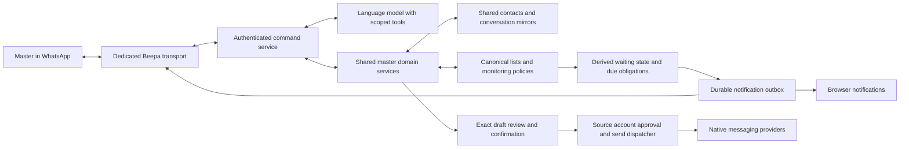

# Beepa WhatsApp master control specification

Implementation: [Telegram master control](2026-10-17-telegram-master-control.md) replaces the proposed WhatsApp command channel.

Status: Draft for product decisions. Date: 2026-10-17. This specifies the feature; the WhatsApp controller is not implemented or deployed.

## Product behavior

The master messages a separate Beepa WhatsApp number to browse shared contacts, manage watch lists, inspect conversations, get updates, and prepare messages from managed accounts such as David and Elliot. Beepa resolves the account and conversation, shows the exact outgoing text, and asks for confirmation before submitting it through the existing source-account sending path.

The existing listing functionality is the single source of truth for membership, monitoring, hanging-conversation rules, deadlines and automatic alerts. WhatsApp and the browser read and update those same list records. Each entry retains its managed account and conversation even when the same person appears under several accounts. Alert presentation remains changeable; the examples below illustrate behavior, not a final interface choice.

### Confirmed decisions

| Area | Behavior |
| --- | --- |
| Control destination | A separate Beepa WhatsApp number, not personal self-chat. |
| Automatic activity alerts | Notify that a message arrived in a specific watched conversation. Allow easy changes by list, conversation, and globally. |
| Hanging conversations | Track both waiting for their reply and an incoming message awaiting our reply. |
| Working hours | No working hours or quiet hours by default. Include optional scheduling settings. |
| Cross-app lists | Keep all watched contacts together regardless of messaging app. Optional channel filters do not split the default watch list. |
| Waiting and reminders | Show waiting status immediately; send a reminder only when the master sets a deadline. |
| Language model | Reuse Beepa’s existing internal model if present; otherwise use OpenRouter with limited relevant shared context. No existing model integration was found in the inspected application code or dependency declarations. |
| Monitoring authority | Lists own monitoring, hanging rules, deadlines and alert policies. WhatsApp and browser controls use the same list API and records. |
| Message review | Resolve context and ask whether the exact message is okay to send. |
| Available contacts | Use contacts already shared by each managed user. Preserve separate outreach histories for the same person under different accounts. |

### Proposed defaults requiring no hidden behavior

Incoming messages trigger activity alerts; outgoing messages remain visible in updates and can be enabled as alerts. “Waiting for them” and “waiting for us” appear immediately. Overdue reminders require an explicitly configured deadline; no default timeout or repeated reminder is added automatically. Digests are optional, initially off.

Keep never-contacted people in an **Uncontacted** filter. They are not automatically hanging under the clarified definition. An explicit “remind me to contact Sam tomorrow” creates a dated obligation.

Generic updates include all watched contacts across apps. “Only WhatsApp conversations” applies an explicit channel filter; using WhatsApp to control Beepa does not change the messaging app of the target conversation.

## Example interactions

### Browse lists and track conversations

> Master: Show my contact lists and what needs attention.
>
> Beepa: Investor follow-ups: 8 waiting for them, 3 waiting for us, 2 uncontacted. Recruiting: 4 waiting for them. This includes watched conversations across all messaging apps.
>
> Master: Watch David’s conversation with Alice and Elliot’s conversation with Ben.
>
> Beepa: Watching David → Alice on iMessage and Elliot → Ben on WhatsApp. New incoming messages will alert you. No overdue reminder deadlines are set.

Names that match several contacts or channels produce a short numbered choice. Beepa must not choose based on whichever account was used most recently. Adding a watch is monitoring only; it does not change source permissions.

### Receive and reply to an alert

Illustrative compact format:

> New message · David → Alice · iMessage
> Investor follow-ups · waiting for us
> Reply to this alert to view the conversation or prepare a response.

The WhatsApp reply reference maps to this exact alert and conversation. “Show the last 15” or “Tell her Tuesday works” in a quoted reply uses that mapping. A short conversation reference is available if quoting is inconvenient. An unqualified reply with multiple possible targets prompts a choice.

The notification layout is a setting: activity only, activity with preview, or grouped updates. Changing layout must not alter routing, permissions, response attribution, or sending confirmation. Default to activity only while the interface is undecided. Preview text is an explicit data-sharing choice.

### Replay context

> Master: Show the last 15 messages with Alice from David’s account.

Return the most recent 15 available messages in chronological order, with an account/channel header, speaker, timestamp and original text. Use deterministic rendering rather than asking the model to reproduce messages from memory. Split into numbered WhatsApp messages to fit the selected transport’s verified limits; split a long individual message with continuation labels, never silently truncate it.

“Earlier 15” uses a stable cursor before the oldest returned message; new arrivals must not cause duplicates or skipped messages. “More context about Alice” can summarize authorized shared profile data and earlier history, distinguishing facts from inference and retaining references to supporting messages. Summaries are explicitly labeled and do not replace requested verbatim history.

Show media type and available caption rather than inventing attachment content. Respect edits, redactions, inaccessible history, incomplete backfill and disconnected sources. State the available range and last successful sync when context is incomplete. Viewing this replay does not mark the source conversation read.

### Prepare and send

> Master: From David’s account, tell Alice Tuesday at 2 works.
>
> Beepa: David → Alice · iMessage · existing conversation · Direct
> Latest message: “Would Tuesday afternoon work?”
> Send: “Tuesday at 2 works for me.”
> Okay to send? Reply to this draft with “send” or ask for a change.

Server-side review binds a draft to the exact account, person, channel, live room generation, source consent revision, context version and message text. Editing produces a new review. Confirmation is single-use and expires after ten minutes, matching the existing CRM review limit. A new incoming message, changed route or changed permissions invalidates the review and asks for confirmation again.

Replying “yes” is valid only when it identifies exactly one current draft. Two outstanding drafts require a quoted reply or draft reference. Quotes from conversation history cannot approve a draft. Repeating the same confirmation returns the existing result and never sends a second message.

Direct messages proceed directly after master confirmation; they never enter the source-user suggestion queue. Share conversations still use their source-user approval flow and show pending, accepted or declined for each specific message. Starting a new conversation retains the existing source-user approval requirement. Beepa reports these differences before confirmation and reports the actual outcome afterward.

For batches, show every account, recipient and personalized body in a numbered review. Confirmation binds the complete reviewed manifest. Report each item independently; “accepted for processing” is not “all sent.” Canceling prevents unsent items where possible and cannot recall delivered messages.

### Ask for updates

Support “What has David sent today?”, “Who replied on this list?”, “What is unread?”, “Who are we waiting on?”, “What do I need to answer?”, and “Only show WhatsApp conversations.” Every response states its list/account/channel scope and time range. Drill down to the source message and exact reply link.

Do not merge these states:

| State | Meaning |
| --- | --- |
| Draft or pending approval | No confirmed native send yet. |
| Sending, sent, delivered, read | Evidence from the source sending and receipt paths. Unknown remains unknown. |
| Responded | An incoming message linked to an outgoing message using the existing response attribution rule. It does not prove agreement or completion. |
| Source unread | The source account’s reported unread state, with freshness. |
| Unseen update | The master has not acknowledged this Beepa update. |
| Waiting for us | An incoming message has no subsequent qualifying outgoing reply; reading it does not answer it. |

The web UI keeps one gray check for sending, two gray for delivered and two blue for read only when native evidence supports it. WhatsApp-rendered reports use explicit text labels: the native WhatsApp ticks on a Beepa bot message describe delivery of that bot message, not delivery of David’s underlying outreach.

## Watch lists and hanging state

Extend the existing list model and canonical CRM journal; do not create an independent WhatsApp watch-list database or duplicate CRM membership. A list member contains stable account/contact bindings and optionally a specific live conversation. A person can occur multiple times with different accounts. The list owns its monitoring enablement, activity filters, alert destinations, explicitly configured deadlines, reminder policy and per-member overrides. Unread counts, waiting status and message results are derived from source events rather than separately editable copies.

“Watch these people” resolves an existing list or creates a list through the same listing service. A conversation-level command updates a member override in a named list; ambiguous membership prompts for the list. Ordinary settings may provide defaults for new lists and global channel availability, but do not hold a competing set of active monitoring rules. WhatsApp stores routing/session references, not its own list configuration.

**Monitoring must never silently change Private to Direct.** Keep monitoring and outreach capabilities explicit within the shared listing model. A monitoring-only list uses already-shared conversations without changing source consent. Existing outreach/CRM list additions retain their established Direct behavior, including changing an explicitly Private conversation, and preview that consequence. Removing the last outreach membership leaves Direct until manually changed. Creating a monitoring-only list does not invoke outreach activation.

Removing membership or disabling monitoring cancels unsent alerts and timers attributable to that list revision, without deleting message history or changing Direct. Another active list may still require an alert. For overlapping lists, evaluate each list’s policy independently, then deduplicate the same source event or due obligation into one delivery per destination with the matching list names. An explicit list deadline never becomes another list’s implicit default. Show which list caused each reminder. A changed bridge generation pauses the old binding until a live authorized replacement is resolved.

The scheduler, browser notification worker and WhatsApp adapter consume the same versioned list-policy projection. Before delivery, recheck the current membership and policy revision. Existing browser follows need a one-time, idempotent migration into monitoring lists; afterward the Follow UI and legacy API must update that same listing service rather than continue writing independent follow rules. Disabling a transport affects delivery availability, not canonical list membership.

### Deterministic obligations

| Condition | Projection and timer |
| --- | --- |
| No recorded outreach | Uncontacted; no automatic overdue timer. Explicit contact-by dates are supported. |
| Confirmed outgoing native send | Waiting for them; use confirmed native sent time as the response-clock baseline. Retain delivery state separately. |
| Incoming message after outreach | Link to the most recent unanswered outgoing message in that account/conversation; create or refresh waiting-for-us state. |
| Outgoing reply after incoming | Resolve that incoming obligation and begin waiting-for-them state. |
| Draft, declined suggestion, failed send or ambiguous send | Do not pretend a message was sent or start its response clock. Show the actionable failure or reconciliation state. |
| Mark resolved, snooze or stop watching | Resolve, defer or disable reminders explicitly; retain the audit history. |

Maintain both message-level obligations and a conversation summary. A reply attributed to the latest unanswered outgoing does not mark all earlier messages answered. The default list view shows current obligations; older unresolved items remain inspectable and can be explicitly resolved. A late native reply that explicitly references an earlier message is shown as additional evidence without silently rewriting the agreed automatic attribution rule.

Use event time and native ordering evidence, not arrival order at the bot. When history is incomplete or stale, show “sync pending” and suppress claims that nobody replied. Reconcile all caught-up events before issuing overdue alerts. Existing response tracking already rejects incomplete or ambiguous native ordering; preserve that behavior.

Deadlines are separate for waiting-for-them and waiting-for-us. They are unset initially; the master can set a particular due date or explicitly enable a relative deadline on the list or a list-member override. Snooze and resolution are recorded through the listing service against the relevant obligation. No quiet hours means elapsed wall-clock time at all hours. Optional working hours require timezone and daylight-saving handling. Notify once per overdue episode by default; repeats require a configured interval. Snooze does not erase the original due time. Monitoring may propose a follow-up draft but never sends it automatically.

## Architecture and existing code

The control channel can be WhatsApp while the target conversation is iMessage or another shared provider. Registering the Beepa bot does not grant access to David’s or Elliot’s personal inboxes. Context and outgoing authority continue through their existing Beepa installations.

| Existing component | Reuse and required work |
| --- | --- |
| `apps/master/crm-store.js`, `shared/model/crm.js` | Existing CRM operation model and account-bound identities. Extend this canonical listing model with monitoring policies and expose shared domain operations for authenticated headless access. |
| `apps/master/crm-batches.js` | Existing route review, immutable manifests, expiry and idempotent submission. Expose equivalent reviewed operations without requiring a browser. |
| `agents/uplink/crm_batch.py`, `crm_approval.py` | Source-side validation, approval and dispatch. Keep this as the sending authority. |
| `agents/uplink/crm_tracking.py`, `agents/enrich/crm_provider_history.py` | Native message identity, receipt and response evidence. Extend projections to watched conversations beyond CRM batches. |
| `master/notifications.py`, `master/notify.py` | Existing authenticated browser notification API, follows and durable delivery evidence. Migrate follows into canonical lists; derive alerts from list policies and keep only delivery state in channel outboxes. |
| `apps/master/notifications.js`, `notification-sw.js` | Browser notification settings and receipts. Add shared watch/settings controls using the same server API. |
| Existing mautrix WhatsApp bridge | Potential transport building block. A dedicated control identity and command authorization layer do not exist yet. |

The current `/admin/notifications` API does not provide general contact lookup, model commands or reviewed sending. The browser CRM adapters are not yet a complete headless master API. New services must preserve their existing rules rather than create a competing sender.

## Transport choice and setup

Use a replaceable transport adapter behind the separate Beepa identity. The number choice is confirmed; the registration method is not.

| Option | Setup and constraint |
| --- | --- |
| Official WhatsApp Business Platform | Candidate for a supported deployment, subject to current account/use-case eligibility. Requires account registration, a dedicated number, credentials, a reachable authenticated webhook receiver and approved proactive-message templates. |
| Dedicated linked-device bridge | Reuses Beepa’s bridge approach with a separate Beepa account, QR/phone pairing and a dedicated control portal. Needs validation of reply references, reconnection and history behavior against the pinned bridge. It is not the official Business API. |
| WhatsApp third-party agent platform | Official terms now describe a 3P platform, but these terms alone do not establish public developer access, regional availability or Beepa eligibility. Investigate access before treating this as an available implementation. |

The Business Platform allows free-form replies within 24 hours of the operator’s last message; outside that window it requires approved templates. Therefore proactive alerts must use an approved template, or a minimal approved “updates available” notice followed by context after the operator replies. Template availability and category must be validated rather than assumed. Surface blocked delivery and use configured browser fallback; do not silently drop alerts or manufacture user activity to reopen the window. [WhatsApp Business Messaging Policy](https://whatsappbusiness.com/policy/)

The linked-device bridge supports QR or phone pairing, configurable history backfill and requires the phone to remain periodically active; its documentation says an offline phone for over two weeks causes linked devices to disconnect. This creates a maintenance requirement and does not guarantee service or account availability. [Mautrix authentication documentation](https://docs.mau.fi/bridges/go/whatsapp/authentication.html)

The third-party agent terms expressly distinguish those agent chats from end-to-end encrypted personal conversations. Select this path only after its access and data handling are understood. [WhatsApp third-party agent terms](https://www.whatsapp.com/legal/third-party-agents-terms)

Before choosing the production adapter, verify current provider eligibility, message-size limits, quoted-reply identifiers, webhook signatures, status callbacks, costs and proactive delivery rules using the registered account. Do not assume an existing personal number can be reused or migrated without affecting its current setup.

## Authentication and model boundaries

Pair the master’s WhatsApp identity from an authenticated master session using a short-lived challenge. Bind the provider-authenticated sender identifier, bot account, exact control chat and master principal. For a bridge, also verify the live portal generation and authenticated sender mapping. Display names, forwarded messages and message-body phone numbers are not identity proof. Reject group control commands and unpaired senders.

The model interprets language, asks clarifying questions and proposes structured tool calls. Deterministic services authorize account access, resolve identifiers, retrieve context, create reviews and execute confirmations. Do not give the model native credentials, shell access, arbitrary Matrix writes or an unrestricted send tool.

Treat retrieved conversations, profiles and attachments as untrusted data. Instructions inside them cannot change settings, expand account scope or approve sends. Confirmation must originate in a new authenticated operator action bound to a server-created draft. Model failure leaves the draft unsent; read-only deterministic commands and cancel remain available.

Reuse the internal model integration if one exists at implementation time; otherwise use OpenRouter. Inspection of Beepa’s application source and dependency declarations found no existing language-model integration, so OpenRouter is the current planned provider. The coding assistant used to build Beepa is not an application model backend. Configure a specific tool-capable model centrally, reusing the same model service for other Beepa features rather than adding a WhatsApp-specific provider configuration.

Load only relevant authorized context, impose token/cost limits, redact credentials and define prompt retention explicitly. Do not promise that hosted processing keeps data local. Account revocation removes tool access, cancels pending work and invalidates cached context and drafts. Provide a master-UI kill switch and recovery path if the WhatsApp account is lost.

Choose the lowest-cost qualified DeepSeek or GPT Luna model through OpenRouter. Start evaluation with deepseek/deepseek-v4.1-flash; compare openai/gpt-6-luna using current provider rates and representative context/output lengths. Only models that pass routing, tool-schema, context and confirmation tests qualify. Pin the selected model centrally; do not switch automatically to an untested model or an uncapped more expensive fallback. This is a planned default, not a configured or tested runtime model.

Model references: [DeepSeek Flash on OpenRouter](https://openrouter.ai/deepseek/deepseek-v4.1-flash), [GPT Luna on OpenRouter](https://openrouter.ai/openai/gpt-6-luna/). Recheck rates at deployment.

## Proposed API and persistence

All following APIs are new contracts, not existing endpoints. Expose them through authenticated master services and typed tools. Browser controls and WhatsApp use the same operations. Remote callbacks use HTTPS and provider authentication; do not expose internal Matrix credentials or unrestricted local administration endpoints.

| Operation family | Required contract |
| --- | --- |
| `lists.list`, `contacts.resolve`, `conversations.resolve` | Return authorized candidates with stable account/person/channel/room bindings; ambiguity is explicit. |
| `context.messages`, `context.person` | Account-bound context, stable pagination cursor, source references, availability and freshness. |
| `lists.create/update`, `lists.members`, `lists.monitoring.update` | One revision-checked listing service for membership, monitoring policies and member overrides. Preview outreach permission changes separately. |
| `lists.updates`, `lists.obligations.resolve/snooze` | Explicit list/account/time scope; deterministic derived status and linked message evidence. |
| `send.prepare`, `send.confirm`, `send.cancel`, `send.status` | Exact immutable review, single-use confirmation, expiry, idempotency and source-side result. |
| `crm.list.edit`, `crm.batch.prepare/confirm/status` | Reuse CRM operations; show authority changes and per-item review/results. |
| `settings.get/update`, `notifications.ack` | Versioned settings; acknowledgement never mutates native read receipts. |

Persist memberships and monitoring policies as versioned operations in the existing canonical list/CRM journal. Persist derived obligations and source watermarks with their list, member and policy revision so they can be rebuilt. Operator bindings, inbound command IDs, draft payload hashes, approval/results, reply-reference mappings and per-channel delivery records are operational state; none may become a second source for active list rules. Store credentials separately from model context and application logs.

Durably record webhook/bridge input before acknowledging it, then process asynchronously. Deduplicate by transport account and incoming message ID. Preserve conversation ordering and serialize conflicting mutations. A model retry must not repeat a mutation. An ambiguous native send is reconciled by exact IDs, never resent by matching text.

Use a durable outbox with bounded retries and explicit failed/blocked states. Preserve the source event ID, watch revision and WhatsApp message ID so each alert reply can resolve its target after restart. Adapter acceptance, delivery and read callbacks are distinct evidence. Do not claim exactly-once network delivery where the provider cannot guarantee it; uncertain bot-message delivery is recorded and bounded, while native-send idempotency remains enforced separately.

Proposed retention: replay from authorized source history rather than duplicating entire conversations; expire draft bodies after the configured audit period; retain minimal command/confirmation deduplication tombstones so old confirmations cannot execute after cleanup. Final retention durations belong in deployment settings and must be selected before launch. Back up state consistently and restore identity bindings, cursors, reviews and outboxes without replaying historical sends.

## Settings and operator controls

Expose the same settings through WhatsApp commands and the master UI: watched lists/conversations across apps; optional channel filters; activity-only/preview/grouped notification presentation; incoming/all-message mode; channel preference and fallback; explicitly enabled deadlines in each direction; snooze; optional repeats and digest; timezone and optional quiet/working hours; model provider/context permissions; account allowlist; read-only or draft-and-confirm mode; transport health and disconnect.

Ordinary changes should state their effective scope immediately: “New-message alerts are off for Investor follow-ups; overdue reminders remain on.” Multi-list or permission-changing edits show a preview. Changes to paired operator identity, credentials and sensitive access require the authenticated settings screen. Source approval requests still belong to the managed user and cannot be accepted as the master.

Provide text commands even if interactive buttons are unavailable. The final notification layout is intentionally open: separate rendering preferences from watch rules and routing so the interface can change without migrating histories.

## Implementation sequence

1. Validate the dedicated-number transport and pair one operator. Exercise authenticated inbound events, quoted replies, reconnect, limits and proactive delivery. Resolve provider/model choices and retention settings.
2. Extract headless master domain services for contact resolution, context pagination, CRM edits and reviewed sends. Add scoped authentication and parity checks against existing UI behavior.
3. Extend canonical list records with monitoring policies and explicit deadlines; migrate browser follows into them. Build derived status projections, hanging timers and channel-independent alert outboxes using those records. Expose list settings and update queries before adding model interpretation.
4. Add the model’s constrained tools, context handling, conversation references, exact review/confirmation and outcome reporting. Keep every action API-triggerable.
5. Wire the same services into master settings and conversation views. Run isolated end-to-end tests, then a controlled live test with the paired operator and explicitly selected test recipients.

These are dependency stages for the full feature, not a reduction to notifications alone. Context replay, individual replies, list management, confirmed sending, updates and hanging reminders are all required for completion.

## Acceptance tests

| Requirement | Pass condition |
| --- | --- |
| Central lists across accounts | The same contact under David and Elliot retains different conversations, histories, unread state and obligations. |
| Cross-app lists | Generic updates include all watched messaging apps; explicit channel filters narrow them. The control-channel app never changes target channel identity. |
| Exact last 15 and more | Correct chronological text, timestamps and speakers; older pagination has no gaps/duplicates during concurrent arrivals; oversized messages are visibly continued. |
| Person context | Only shared authorized information is returned; unavailable history and model inference are labeled; no cross-account leakage. |
| Individual alert replies | Replies to two interleaved alerts resolve their original routes. Missing/unknown references prompt clarification. |
| Sending confirmation | Account, recipient, channel and exact text are reviewed. Bare yes with multiple drafts, expired drafts and changed context cannot send. |
| Direct and Share | Direct bypasses suggestions after master confirmation. Share produces individually traceable pending/accepted/declined results. New conversations retain source approval. |
| Batch sending | Every item is reviewed; duplicate confirmation/restart does not duplicate sends; partial failures remain per-item. |
| Watch versus CRM authority | Watching never changes Private/Direct. Explicit CRM membership changes apply the established Direct behavior and preview it. |
| Waiting and replies | Native ordering links the next incoming to the latest unanswered outgoing; earlier items remain inspectable. Incoming replies and local-user sends update obligations without a WhatsApp command. |
| Hanging reminders | Waiting appears immediately, but no reminder fires without an explicit deadline. Both directions, uncontacted deadlines, snooze, resolution, deadline changes and no-quiet-hours default work under a fake clock. Optional timezones/DST are covered. |
| Evidence and unread | Sending/delivered/read/response/source-unread/master-unseen remain distinct, including unsupported receipts and stale sources. |
| Offline recovery | Reconcile caught-up replies before reminding; no startup alert storm; duplicate callbacks and ambiguous send results never duplicate outreach. |
| Transport constraints | Outside-window templates, unavailable templates, rejected payloads, message limits, blocked operator and fallback have visible outcomes. |
| Authorization | Unpaired senders, forged quote references, prompt injection, revoked sharing and obsolete portal generations cannot access or send. |
| Settings and API parity | All routine operations work without computer use; UI changes and WhatsApp commands update the same versioned settings. |
| Single source of truth | Membership, deadlines and alert-policy changes through lists, WhatsApp or the browser converge on the same journal revision. Legacy follows migrate once; no adapter retains independent rules. Overlapping lists deduplicate delivery and identify the responsible policies. |
| Maintenance | Restart/backup/restore preserves pending reviews, obligations and deduplication. Health alerts identify source versus control-transport failures. |

Run repository integration tests through `tests/integration/run.sh` with disposable marked stacks and synthetic accounts. Do not provision test users on the live master. Live tests should record exact source and control-message IDs and verify actual device receipt separately from provider acceptance. No live WhatsApp messages are authorized or sent by this specification task.

## Remaining product and setup decisions

Product choices are settled for a single canonical listing system, cross-app watch lists, immediate waiting status, reminders only on explicit deadlines, and hosted processing of limited relevant context. Reuse the existing internal model if available; with none found, use OpenRouter. The specific model can be selected as an implementation default. The WhatsApp transport remains to be validated; no provider credentials are assumed to be available.

The user-supplied temporary OpenRouter key is now staged in protected, Git-ignored master configuration and passed the authenticated provider check on 2026-10-17. DeepSeek Flash is staged as the planned model; no application model controller has been implemented yet. The remaining user setup item is a dedicated Beepa WhatsApp number/account. Pair the operator identity during setup rather than asking for credentials in chat. Existing lists remain authoritative and can be selected for monitoring then; no duplicate list entry is required. Implementation also needs a validated transport and an always-running host. Official webhook deployment additionally needs a public HTTPS callback with validated provider authentication. Secrets should never be pasted into WhatsApp commands.

Final notification appearance remains open. Validate a compact conversation alert first and allow its preview/grouping behavior to change without changing the underlying watch lists. Voice commands, outbound media and group control are extensions; the required baseline is natural-language text control plus visible media placeholders in context.

For an initial linked-device setup, obtain a dedicated mobile number with SMS or voice verification, install WhatsApp Business on the operator’s Android phone, register the new number and name the profile Beepa. Personal WhatsApp can remain on its existing number. Pair the dedicated Beepa account to the control bridge when that integration is ready. App registration alone does not create the bot or enroll it in the official Business Platform; selecting that transport requires its own onboarding.

Account setup references: [WhatsApp Business for Android](https://play.google.com/store/apps/details?id=com.whatsapp.w4b), [WhatsApp Business registration](https://faq.whatsapp.com/1344487902959714/?locale=en_US).

## Related specifications

- [Master CRM design](2026-10-12-master-crm-design.md)
- [CRM provider ordering evidence](2026-10-12-crm-provider-order-evidence.md)
- [Master browser notifications and API](2026-10-13-master-notifications.md)
